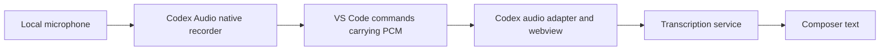

# Speech-to-text investigation — 2026-10-14

Codex IDE dictation captures microphone audio through a separate local native extension, `openai.codex-audio`.
This avoids VS Code's webview microphone restrictions and keeps recording on the user's computer when the workspace
runs remotely. The installed Codex and Codex Audio manifests both declare VS Code `^1.96.2`. Alpha's existing
`^1.125.0` baseline is therefore not an apparent version obstacle to this architecture. This is a source-based
feasibility finding, not a live recording certification or proof of operation on the minimum declared host.

## Evidence inspected

The Windows extension installation under `%USERPROFILE%\.vscode\extensions` contains:

| Component                            | Installed version         | Relevant manifest evidence                                                         |
| ------------------------------------ | ------------------------- | ---------------------------------------------------------------------------------- |
| `openai.chatgpt`                     | `26.917.62051`, win32-x64 | `engines.vscode: ^1.96.2`; dependency on `openai.codex-audio`                      |
| `openai.codex-audio`                 | `26.1007.21434`           | `engines.vscode: ^1.96.2`; `extensionKind: ["ui"]`; no proposed API declarations   |
| Bundled `@picovoice/pvrecorder-node` | `1.2.9`                   | Native recorder bindings bundled for supported operating systems and architectures |

These are the locally inspected versions, not a claim about the first release that introduced dictation.
OpenAI's [Codex Audio Marketplace listing](https://marketplace.visualstudio.com/items?itemName=openai.codex-audio)
independently documents local microphone support, including SSH and WSL, and operating-system microphone permission.

The following installed files establish the implementation:

- Codex `package.json` and `out/extension.js`: companion dependency and a capture adapter that calls
  `_codex.microphone.start`, `.read`, `.stop`, and `.cancel` through `vscode.commands.executeCommand`.
- Codex Audio `package.json`: local UI extension placement and activation through `_codex.microphone.available`.
- Codex Audio `out/extension.js`: recording-session ownership, a Node worker thread, bounded buffering, and cleanup.
- Codex Audio `out/recorder-worker.js`: `PvRecorder(1600)`, native synchronous frame reads inside the worker, and
  recorder stop/release on exit.
- Codex `webview/assets/app-initial-e47a6bae212d.js`: native PCM capture integration, synthesized audio tracks,
  recording controls, and dictation capability checks.
- Codex `webview/assets/app-initial-de4359f78ed1.js`: transcription request paths and streaming-dictation transport.

Fingerprints for reproducibility:

| Installed artifact                   | SHA-256                                                            |
| ------------------------------------ | ------------------------------------------------------------------ |
| Codex `out/extension.js`             | `7ba6208c447c393e050a8ba46893e9e1aa4abd718cb4a8610fa87b12942633bc` |
| Codex Audio `out/extension.js`       | `bdfdb5b9bb1be13dc37befd800a82e479843516080079c935673a3327012d03e` |
| Codex Audio `out/recorder-worker.js` | `c30a838b6a40422b0afad2c789e8e11024ad865ea3e2c6ab3621e08648e4bde2` |

## How Codex makes this work

The companion runs in the local Node extension host. VS Code documents that `extensionKind: ["ui"]` keeps an extension
close to local devices even with a remote workspace. The main workspace extension communicates with the companion
through commands. See [Extension Host](https://code.visualstudio.com/api/advanced-topics/extension-host) and
[Supporting Remote Development](https://code.visualstudio.com/api/advanced-topics/remote-extensions).

The native recorder reads microphone samples outside the browser webview. Its blocking reads run in a worker thread.
The companion returns base64 PCM chunks across the command boundary. Codex converts the samples to `AudioData` and
feeds a `MediaStreamTrackGenerator`, allowing the UI to use audio recording machinery without asking the webview to
open the physical microphone. The UI can also assemble the samples into a WAV blob.

Capture and recognition are separate. The inspected UI includes a multipart `/transcribe` request and a
`/codex/dictation-stream-connect-info` request for streaming transport. These are Codex implementation details;
they do not establish a supported transcription API for Alpha or identify the backend model.

The inspected IDE dictation capability requires a microphone adapter, `MediaRecorder`, ChatGPT authentication,
and a remotely controlled feature flag. Thus, a sufficiently new editor alone does not establish availability.
The audio companion supports Windows and macOS on x64/arm64, and Linux on x64 in this build. Its manifest has no browser
entry point, so this local-native design does not establish support for browser-only VS Code.

The companion also implements one active recording, session identifiers, a bounded audio queue, an inactivity timeout,
a recording-duration limit, and stop/cancel/dispose cleanup. These lifecycle details matter for a future Alpha design.

## What VS Code 1.125.0 permits

The exact `1.125.0` source still blocks direct microphone capture in extension webviews at two layers:

1. The outer webview iframe and inner content iframe do not delegate microphone permission in their `allow` lists.
   See [webviewElement.ts, lines 416–427](https://github.com/microsoft/vscode/blob/1.125.0/src/vs/workbench/contrib/webview/browser/webviewElement.ts#L416-L427)
   and [pre/index.html, lines 1024–1038](https://github.com/microsoft/vscode/blob/1.125.0/src/vs/workbench/contrib/webview/browser/pre/index.html#L1024-L1038).
2. Electron's permission handlers allow `media` for VS Code's own workbench, but omit it from the webview permission
   allowlist. See [app.ts, lines 191–232](https://github.com/microsoft/vscode/blob/1.125.0/src/vs/code/electron-main/app.ts#L191-L232).

Consequently, enabling scripts, adding `media-src` to Alpha's CSP, or putting another iframe inside Alpha's webview
does not grant physical microphone access. Audio playback support is separate from recording permission.
Microsoft's [issue 250568](https://github.com/microsoft/vscode/issues/250568) also reports the permission-policy failure
for `navigator.mediaDevices.getUserMedia({ audio: true })` on VS Code 1.100.3. The exact-host source above is the stronger
evidence for Alpha's present baseline.

The stable [1.125.0 WebviewOptions contract](https://github.com/microsoft/vscode/blob/1.125.0/src/vscode-dts/vscode.d.ts#L9897-L9953)
has no microphone permission switch. Speech-provider registration remains in
[vscode.proposed.speech.d.ts](https://github.com/microsoft/vscode/blob/1.125.0/src/vscode-dts/vscode.proposed.speech.d.ts),
not the stable API. That proposal registers a provider; it does not give Alpha a stable API to capture dictation into
its own webview. Codex Audio's inspected implementation uses native capture and ordinary commands.

## What this establishes about Alpha's earlier attempt

Current Alpha sources and the inspected reachable Git history did not reveal the earlier speech-to-text implementation.
The history content search found the existing voice-divergence design discussion, but no retained microphone feature.
Selected source trees in the adjacent preserved and Roo fork checkouts also yielded no matching implementation.
The original failure therefore cannot be conclusively assigned to a particular Alpha code path or error.

If the old implementation tried browser microphone capture inside the React webview, the verified VS Code restrictions
would explain its failure before transcription started. If it launched a recorder from a remote workspace host, accessing
the wrong machine's audio devices is another possibility, not an established finding about that attempt.

Alpha currently uses an ordinary webview in `src/core/webview/AlphaProvider.ts`, with CSP construction in
`src/core/webview/webviewHtml.ts`. Its existing `media-src` permits media resource loading; it does not grant recording
authority. `src/package.json` confirms the current VS Code `^1.125.0` baseline.

## Implications for a future Alpha implementation

Keep capture, transcription, and composer integration as separate responsibilities:

1. Own a small local native capture adapter, with a UI companion when the main extension can run remotely. Package and
   validate native dependencies for each supported platform. Keep blocking capture off the extension-host event loop.
2. Use a supported transcription service or an explicitly selected local engine behind a provider-neutral interface.
   The selected coding model need not provide speech recognition. Codex's private commands and service paths are not a
   supported integration contract for Alpha; the companion manifest declares `api: "none"`.
3. Insert recognized text into the existing composer edit buffer with explicit recording, stopping, cancellation,
   failure, and retry states. Preserve edits made during transcription and route results to the originating composer.
4. Validate permission denial, missing/busy devices, concurrent composers, cancellation, reload/disposal, bounded
   buffering, local versus WSL/SSH placement, and packaged native loading on exact VS Code 1.125.0. Follow this with
   a user-operated microphone check on each supported platform. A stable-API-compatible design still needs these tests.

No host-baseline increase or parallel agent runtime is indicated by this investigation.

## Provenance and verification limits

Research date: 2026-10-14, America/New_York. VS Code source was fetched at tag `1.125.0`.
OpenAI Codex CLI source was inspected at commit `160b2b1ef62114eeb41e41e5e3be0000d944b713`, including
[`realtime.rs`](https://github.com/openai/codex/blob/160b2b1ef62114eeb41e41e5e3be0000d944b713/codex-rs/tui/src/chatwidget/realtime.rs),
[`recording_controls_tests.rs`](https://github.com/openai/codex/blob/160b2b1ef62114eeb41e41e5e3be0000d944b713/codex-rs/tui/src/chatwidget/realtime/recording_controls_tests.rs),
and the separate native voice-helper work. CLI two-way voice is a different surface from IDE composer dictation;
the installed extension artifacts above are the evidence for how IDE microphone capture works.

Nine static assertions passed against the inspected manifests, recorder bundles, exact-host permission lists,
iframe rules, and stable/proposed speech API declarations. Sources, links, and file landmarks were reviewed.
No microphone was activated, no audio was submitted, and no live minimum-version compatibility test was performed.
No Alpha runtime code changed. Unit suites and the exact-host smoke gate were not run for this documentation-only
investigation; they do not independently establish physical microphone access.
